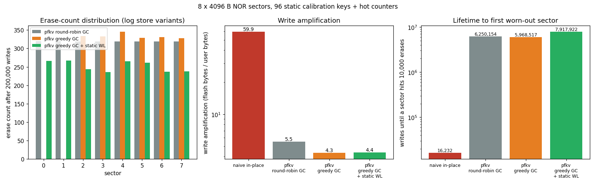

# powerfail-flash-kv

pfkv is a small key-value store in C11 for keeping settings, calibration values and counters in raw NOR flash on Cortex-M microcontrollers, where power can drop in the middle of any program or erase. I cut power 32,651 times, at every flash operation of three workloads (clean cuts, torn writes and erases, and cuts during recovery itself), and it never lost a write that `pfkv_put()` had acknowledged. Spreading erases across sectors also made the flash last about 488x longer than a naive read-erase-rewrite store: 7.9M writes against 16K before the first sector wore out.



The core is 4.1 KB of code and about 1.5 KB of RAM. It runs on FreeRTOS in QEMU (Cortex-M3) but has not been on a real board yet.

## Why rewriting a sector is the problem

The usual way to keep config in flash without a filesystem is to read a sector, erase it and write it back. If power drops between the erase and the program, every key in that sector is gone. That one sector also takes all the wear.

pfkv never overwrites anything. Each write is appended to a log as a record with a header CRC, a payload CRC and a commit unit that is programmed separately, last. At mount, a record with a bad CRC or no commit unit is skipped, so the old value is still there. The awkward case was a torn header. Then the record length can't be trusted either, so mount gives up on the rest of that sector and moves on to a fresh one.

When the log fills up, garbage collection copies the live records out of a victim sector, invalidates the victim's header and only then erases it. That order matters a lot: a build that skipped the invalidation step failed over 600k checks in the power-cut harness. If power drops mid-GC, the next mount finds every sector holding data, throws away the newest one (it only holds copies) and scans again. Static wear leveling moves cold data off barely-used sectors once the erase-count gap gets too big, which is what keeps the erase counts close together.

Nearly all of the testing runs against a NOR flash simulator in `sim/flash_sim.c`. It enforces the real rules (bits only go from 1 to 0, one program per unit, whole-sector erase) and can cut power at the Nth operation, either cleanly or partway through. The harness replays each workload with a cut at every operation, remounts, and checks that acknowledged writes have their exact values, the in-flight write is all or nothing, and the store still accepts new writes.

## Trying it

```sh
make cli                                                  # host build of the store + NOR simulator
./build/host/pfkv_cli settings.img put wifi/ssid lab-net  # write a setting to a flash image
./build/host/pfkv_cli settings.img list                   # remount the image and list all settings
```

`settings.img` is a 32 KiB image of eight 4 KiB sectors, and each run remounts it from scratch like a device after a reset. `list` prints `wifi/ssid=lab-net`. The other commands are `get KEY`, `del KEY` and `stats`, which shows erase counts and live bytes per sector.

```sh
make test       # 20 Unity tests under AddressSanitizer and UBSan
make powercut   # the full power-cut run, non-zero exit on any failure
make qemu-test  # FreeRTOS image in QEMU, multi-task stress test checked over UART
```

`make bench` reruns the wear benchmark and redraws the plot. On Ubuntu, `scripts/setup_ubuntu.sh` installs gcc, arm-none-eabi-gcc, qemu-system-arm and matplotlib.

To put it in firmware you implement read, program and erase for your part and call `pfkv_mount()` once at boot.

- Porting, sector sizing and limits: [docs/integration.md](docs/integration.md)
- What the tests check, with per-workload numbers: [docs/testing.md](docs/testing.md)
- On-flash format and the full wear benchmark: [docs/design.md](docs/design.md)
- Code size and stack use: [docs/footprint.md](docs/footprint.md)

## Known issues and next steps

- It has only been tested in the simulator and QEMU. Real NOR parts can leave unstable bits after an interrupted program, raise ECC faults on half-programmed words and brown out in ways the simulator doesn't model. Running the same harness on a board is the next step.
- Small values are expensive. A record carries a 16-byte header, padding and a commit unit, so a 4-byte counter with a 10-byte key takes 40 bytes. Packing related values into one key helps.
- If a torn erase wipes a sector's header, its erase count is lost and mount sets it to the highest known count. It's safe, but wear leveling then treats that sector as more worn than it is.
- Recovering from an interrupted GC means redoing it, which costs one extra sector erase.

FreeRTOS (`third_party/freertos/`) and Unity (`third_party/unity/`) are included under their MIT licenses.

Project period: 2026-07-21 to 2026-10-12.
